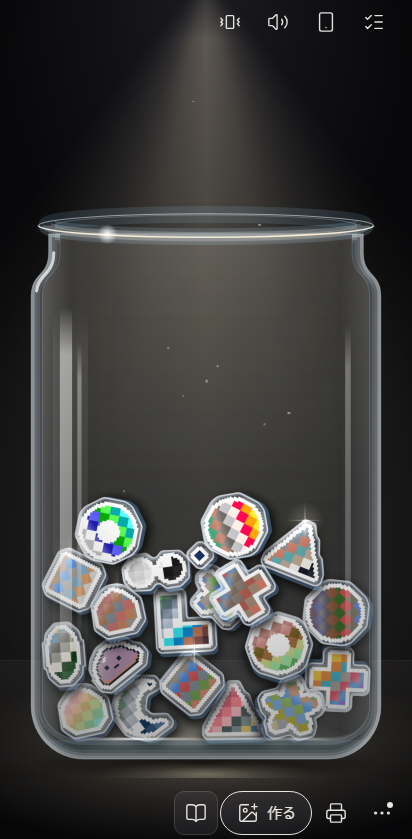

# ステッカー帳

32×32・16色のドット絵ステッカーを、QRコードやリンクで交換して集めるWebアプリ。サーバーは置かず、静的ホスティング(GitHub Pagesなど)だけで動く。データは端末のブラウザ(IndexedDB)の中にだけ残る。

| 空のシール帳                                        | ステッカーを貼った状態                                 | 作成                                                  |
| --------------------------------------------------- | ------------------------------------------------------ | ----------------------------------------------------- |
|  |  |  |

| QR                                                | 印刷                                                 |
| ------------------------------------------------- | ---------------------------------------------------- |
|  |  |

画像はすべてアプリ自身のサンプルステッカー(e2eの固定データ)。

## 使い方

1. 作る: 画像を選ぶと32×32・16色のドット絵になる。パレットを選び、SNSの種類とIDを入れて「ポケットに入れる」。
2. 見せる: 自分のステッカーを選んで「QRを出す」。
3. 受け取る: 相手のQRを標準カメラで読むと、アプリが開いてステッカーがシール帳のポケットに入る。SNS上のリンクを開いても同じ。
4. 貼る: ポケットから1枚取り出し、裏紙からはがしてページの上で離す。押さえると貼り付く。
5. 交換する: 双方向にはQRを2回読む(A→B、B→A)。

## 機能

- 画像のインポート(パレット自動選択、固定パレットモード)、16色のうち1色を透明にできる
- QRコードとリンクでの受け渡し(1枚のステッカーを1つのURLに収める)
- シール帳(ドラッグで配置、ページ追加、捨てる/元に戻す、めくれるページ)
- ポケット(受け取ったシールと作ったシールが入る。裏紙からはがして貼る)
- シールの裏(くれた人と日付)と、もらった人の一覧
- 素材(ふつう、キラ、ぷっくり、ラメ、クリア、箔、蓄光)。作った人が選び、シールと一緒に渡る。交換した人が増えると使える素材が増える
- 電気を消す(蓄光のシールだけが光り、指の所を懐中電灯で照らす。周りの明るさを測れる端末では自動)
- 瓶モード(ステッカーをアクリルブロックにして瓶に落とす。下の「瓶モード」)
- A4への印刷(SVG出力、カットライン、同じステッカーを並べる)
- バックアップの書き出しと読み込み
- ライト/ダーク表示、PWA

詳細と未確認の項目は [docs/progress.md](docs/progress.md)。

## 瓶モード

ステッカーが 1 枚以上あると、ツールバーの瓶のボタンでシール帳と切り替えられる(選んだ表示は保存され、次に開いたときもそのまま)。ステッカーはアクリルブロックになって瓶に落ちる。



**3D 版**(WebGL2 が使える端末。three.js と rapier3d): 木の机の上に置かれたガラスの瓶を、少し上から見る。上からのスポットライトが机に光だまりを作り、瓶とブロックの影が落ちる。ブロックはステッカーの輪郭を押し出した厚みのあるアクリルで、絵はその中にあり、縁が光る。ブロックはドラッグで持ち上げて机に出せる。瓶そのものもドラッグで机の上を滑らせたり、縁を引いて倒したりできる(「瓶を立て直す」で元に戻り、ブロックも瓶に戻る)。WebGL2 が使えない端末では、次の 2D 版になる(アドレスに `?jar=2d` を付けても 2D になる)。3D のコードは約 5MB(three.js と物理エンジンの WASM を含む)で、瓶を最初に開くまで読み込まない。オフライン用の事前キャッシュには入れず、最初に使ったときにキャッシュする。

以下は 2D 版の説明(音、選択、ブロックの形、ドラッグ、選ぶ・シャッフルは 3D 版でも同じ)。

- 瓶モードはいつも暗い(システムやアプリのテーマによらない)。暗い部屋に瓶が置いてあって、真上の明かりが当たっている。明かりの円錐、テーブルの上の光だまり、瓶の影と薄い映り込み、縁の光、床に落ちる光。ブロックは明かりに近い上のほうが明るく、下や外側は暗い。回ると縁がきらっと光る。シール帳に戻るとシステムのテーマに戻る。動きを減らす設定では、ほこりの動かない静止した絵
- 音(合成。音声ファイルなし): ブロック同士は「カチッ」、ガラスには「コン」、底には「ドン」。ぶつかる強さで大きさと明るさが変わり、弱い接触は鳴らない。「振る」は細かいカタカタ、新しく入るブロックは小さな「ぽとん」、止まっている山は無音。同時に 12 音まで、音量は控えめ(-12dB、リミッター付き)。ツールのスピーカーのボタンで切り替わり、選択は保存される(既定はオン)。最初の操作(瓶への切り替え、振る、触る)までは鳴らず、ページを隠すか瓶を出ると止まる。動きを減らす設定では鳴らず、ボタンもない
- ブロックはステッカーの輪郭で切り抜いたアクリル(白いふちの外側に少し余白)。物理も同じ形(凸な部品 6 個までに分解、ほぼ凸なら凸包 1 個)なので、形のとおりに噛み合って転がる。透明なステッカーだけの場合や小さすぎる場合は小さな丸い四角
- 瓶は広口のガラス瓶(縁、首、厚い壁と底、丸い底の角、反射、床の影)。透けるので背景も見える。壁の内側の輪郭がそのまま物理の壁

- 瓶に入るのは一部だけ: 既定は**ランダムに 40 枚**(最大 120 枚)。「シャッフル」で入れ替え、「選ぶ」で入れるステッカーを自分で決められる(選ぶと固定になり、「ランダムに戻す」で戻る)。ランダムの中身は保存した種から決まるので、開き直しても同じ
- 後から作った・受け取ったステッカーを、瓶に入れる処理はない。固定のときは入らない。ランダムのときは、全部で 40 枚以下ならそのまま入り、それより多いと他のステッカーと同じ抽選の対象になる(入るかどうかは種で決まる)。入れたいときは「選ぶ」。シール帳から捨てたものは瓶からも消える
- ブロックはドラッグで投げられる。タップすると選択されて、シール帳と同じ操作バー(QR、捨てる)が出る。「振る」ボタン、タッチ端末では端末の傾きでも動く(iOS は初回に許可が要る)。強くぶつかると、対応する端末では軽く振動する
- 動きを減らす設定では、静止した山を 1 枚描くだけ(振る・傾きのボタンもなし)
- 瓶のコード(物理エンジンの matter-js を含む)は、最初に瓶を表示したときに読み込む。端末が重いときは、物理の更新頻度、解像度、動かすブロックの数を自動で下げる
- 遅い端末でも、少しもっさりしても使えることを優先している

## プライバシー

QRにはSNSのIDが入っている。QRを読んだ人はだれでもそのIDを知る。名前や位置情報は載せない。IDの持ち主は確かめられないので、なりすましには対応しない。

## 開発

```sh
vp install        # 依存関係
vp dev            # 開発サーバー
vp run verify     # vp check + tsc + React Compiler の検査 + 単体テスト
vp run test:e2e   # Playwright(Chromium と WebKit)
```

スクリーンショットは `SCREENS=1 vp run test:e2e` で `test-results/screens/` に出る。

## 構成

- `src/core`: 純粋なロジック(ペイロード、パレット、量子化、QR、印刷、シール帳)。DOMもブラウザの保存先も使わない
- `src/data`: ブラウザAPIのラッパー(IndexedDB、リンクの受信、設定)
- `src/ui`: React
- `docs/plan.md`(仕様), `docs/progress.md`(進捗), `docs/roadmap.md`(今後の予定)

## ドキュメント

- [実装計画](docs/plan.md)
- [進捗](docs/progress.md)
- [ロードマップ](docs/roadmap.md)
