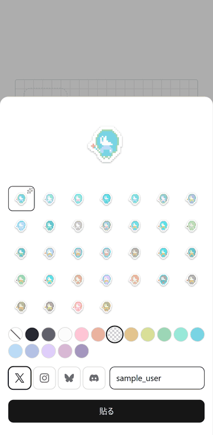

# ステッカー帳

32×32・16色のドット絵ステッカーを、QRコードやリンクで交換して集めるWebアプリ。サーバーは置かず、静的ホスティング(GitHub Pagesなど)だけで動く。データは端末のブラウザ(IndexedDB)の中にだけ残る。

| 空のシール帳                                        | ステッカーを貼った状態                                 | 作成                                                  |
| --------------------------------------------------- | ------------------------------------------------------ | ----------------------------------------------------- |
|  |  |  |

| QR                                                | 印刷                                                 |
| ------------------------------------------------- | ---------------------------------------------------- |
|  |  |

画像はすべてアプリ自身のサンプルステッカー(e2eの固定データ)。

## 使い方

1. 作る: 画像を選ぶと32×32・16色のドット絵になる。パレットを選び、SNSの種類とIDを入れて「ポケットに入れる」。
2. 見せる: 自分のステッカーを選んで「QRを出す」。
3. 受け取る: 相手のQRを標準カメラで読むと、アプリが開いてステッカーがシール帳のポケットに入る。SNS上のリンクを開いても同じ。
4. 貼る: ポケットから1枚取り出し、裏紙からはがしてページの上で離す。押さえると貼り付く。
5. 交換する: 双方向にはQRを2回読む(A→B、B→A)。

## 機能

- 画像のインポート(パレット自動選択、固定パレットモード)、16色のうち1色を透明にできる
- QRコードとリンクでの受け渡し(1枚のステッカーを1つのURLに収める)
- シール帳(見開きのノート。紙をつまんでめくる。シールは縁を引っぱるとはがれて持ち上がり、好きな所に貼り直せる。端で止めるとページがめくれる。ページ追加、捨てる/元に戻す)
- ポケット(受け取ったシールと作ったシールが入る。ポケットから直接引き出して貼るか、開いて選び、裏紙からはがして貼る。貼ったシールをポケットの上で離すと戻る)
- シールの裏(くれた人と日付)と、もらった人の一覧
- 素材(ふつう、キラ、ぷっくり、ラメ、クリア、箔)。作った人が選び、シールと一緒に渡る。交換した人が増えると使える素材が増える
- 机のマットとノート PC にもシールを貼れる(マットは 4 枚まで。ノート PC は 3 人と交換すると机に届く)
- 机の上の光(端末の時計だけで決まる): 朝は窓の光と観葉植物の影、夕方は橙の低い光とブラインドの縞、夜は机のライト。キラと箔は光の向きと色で見え方が変わる
- A4への印刷(SVG出力、カットライン、同じステッカーを並べる)
- バックアップの書き出しと読み込み
- ライト/ダーク表示、PWA

詳細と未確認の項目は [docs/progress.md](docs/progress.md)。

デバッグ: アドレスに `?debug` を付けて一度開くと、ツールバーに虫のボタンが出る(覚えておく)。デバッグメニューでは、交換した人数によらず素材をすべて使えるようにできる。ブラウザのコンソールでは `stickerNotesDebug.unlockAll()`(戻すのは `stickerNotesDebug.unlockAll(false)`、やめるのは `stickerNotesDebug.off()`)。

## プライバシー

QRにはSNSのIDが入っている。QRを読んだ人はだれでもそのIDを知る。名前や位置情報は載せない。IDの持ち主は確かめられないので、なりすましには対応しない。

## 開発

```sh
vp install        # 依存関係
vp dev            # 開発サーバー
vp run verify     # vp check + tsc + React Compiler の検査 + 単体テスト
vp run test:e2e   # Playwright(Chromium と WebKit)
```

スクリーンショットは `SCREENS=1 vp run test:e2e` で `test-results/screens/` に出る。

## 構成

- `src/core`: 純粋なロジック(ペイロード、パレット、量子化、QR、印刷、シール帳)。DOMもブラウザの保存先も使わない
- `src/data`: ブラウザAPIのラッパー(IndexedDB、リンクの受信、設定)
- `src/ui`: React
- `docs/plan.md`(仕様), `docs/progress.md`(進捗), `docs/roadmap.md`(今後の予定)

## ドキュメント

- [実装計画](docs/plan.md)
- [進捗](docs/progress.md)
- [ロードマップ](docs/roadmap.md)
