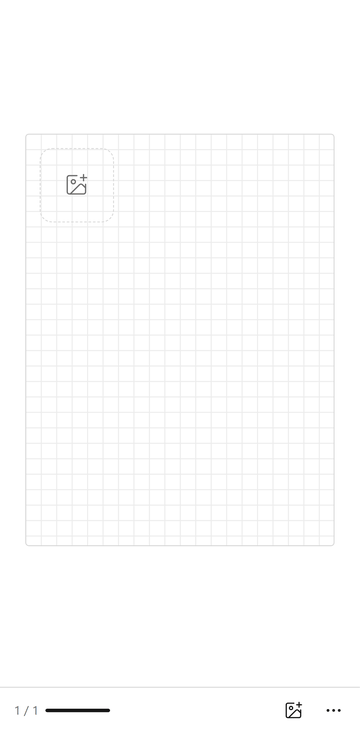
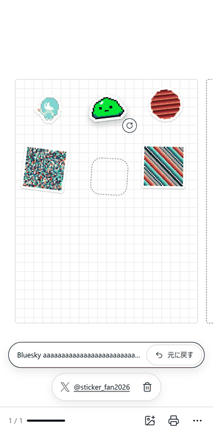
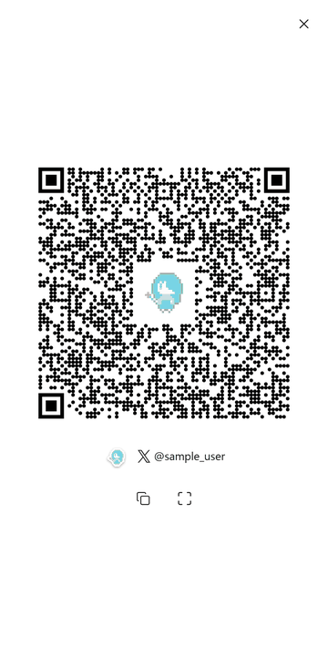
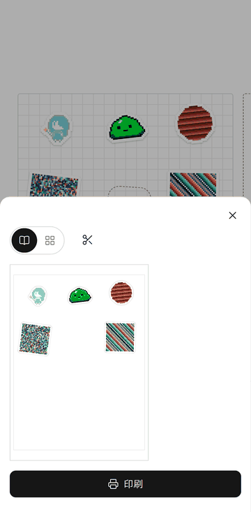

# ステッカー帳

32×32・16色のドット絵ステッカーを、QRコードやリンクで交換して集めるWebアプリ。サーバーは置かず、静的ホスティング(GitHub Pagesなど)だけで動く。データは端末のブラウザ(IndexedDB)の中にだけ残る。

| 空のシール帳                                        | ステッカーを貼った状態                                 | 作成                                                  |
| --------------------------------------------------- | ------------------------------------------------------ | ----------------------------------------------------- |
|  |  |  |

| QR                                                | 印刷                                                 |
| ------------------------------------------------- | ---------------------------------------------------- |
|  |  |

画像はすべてアプリ自身のサンプルステッカー(e2eの固定データ)。

## 使い方

1. 作る: 画像を選ぶと32×32・16色のドット絵になる。パレットを選び、SNSの種類とIDを入れて「貼る」。
2. 見せる: 自分のステッカーを選んで「QRを出す」。
3. 受け取る: 相手のQRを標準カメラで読むと、アプリが開いてステッカーがシール帳に貼られる。SNS上のリンクを開いても同じ。
4. 交換する: 双方向にはQRを2回読む(A→B、B→A)。

## 機能

- 画像のインポート(パレット自動選択、固定パレットモード)、16色のうち1色を透明にできる
- QRコードとリンクでの受け渡し(1枚のステッカーを1つのURLに収める)
- シール帳(ドラッグで配置、ページ追加、捨てる/元に戻す)
- 瓶モード(ステッカーをアクリルブロックにして瓶に落とす。下の「瓶モード」)
- A4への印刷(SVG出力、カットライン、同じステッカーを並べる)
- バックアップの書き出しと読み込み
- ライト/ダーク表示、PWA

詳細と未確認の項目は [docs/progress.md](docs/progress.md)。

## 瓶モード

ステッカーが 1 枚以上あると、ツールバーの瓶のボタンでシール帳と切り替えられる(選んだ表示は保存され、次に開いたときもそのまま)。ステッカーはアクリルブロックになって瓶に落ちる。

- 瓶に入るのは一部だけ: 既定は**ランダムに 40 枚**(最大 120 枚)。「シャッフル」で入れ替え、「選ぶ」で入れるステッカーを自分で決められる(選ぶと固定になり、「ランダムに戻す」で戻る)。ランダムの中身は保存した種から決まるので、開き直しても同じ
- 後から作った・受け取ったステッカーを、瓶に入れる処理はない。固定のときは入らない。ランダムのときは、全部で 40 枚以下ならそのまま入り、それより多いと他のステッカーと同じ抽選の対象になる(入るかどうかは種で決まる)。入れたいときは「選ぶ」。シール帳から捨てたものは瓶からも消える
- ブロックはドラッグで投げられる。タップすると選択されて、シール帳と同じ操作バー(QR、捨てる)が出る。「振る」ボタン、タッチ端末では端末の傾きでも動く(iOS は初回に許可が要る)。強くぶつかると、対応する端末では軽く振動する
- 動きを減らす設定では、静止した山を 1 枚描くだけ(振る・傾きのボタンもなし)
- 瓶のコード(物理エンジンの matter-js を含む)は、最初に瓶を表示したときに読み込む。端末が重いときは、物理の更新頻度、解像度、動かすブロックの数を自動で下げる
- 遅い端末でも、少しもっさりしても使えることを優先している

## プライバシー

QRにはSNSのIDが入っている。QRを読んだ人はだれでもそのIDを知る。名前や位置情報は載せない。IDの持ち主は確かめられないので、なりすましには対応しない。

## 開発

```sh
vp install        # 依存関係
vp dev            # 開発サーバー
vp run verify     # vp check + tsc + React Compiler の検査 + 単体テスト
vp run test:e2e   # Playwright(Chromium と WebKit)
```

スクリーンショットは `SCREENS=1 vp run test:e2e` で `test-results/screens/` に出る。

## 構成

- `src/core`: 純粋なロジック(ペイロード、パレット、量子化、QR、印刷、シール帳)。DOMもブラウザの保存先も使わない
- `src/data`: ブラウザAPIのラッパー(IndexedDB、リンクの受信、設定)
- `src/ui`: React
- `docs/plan.md`(仕様), `docs/progress.md`(進捗), `docs/roadmap.md`(今後の予定)

## ドキュメント

- [実装計画](docs/plan.md)
- [進捗](docs/progress.md)
- [ロードマップ](docs/roadmap.md)
