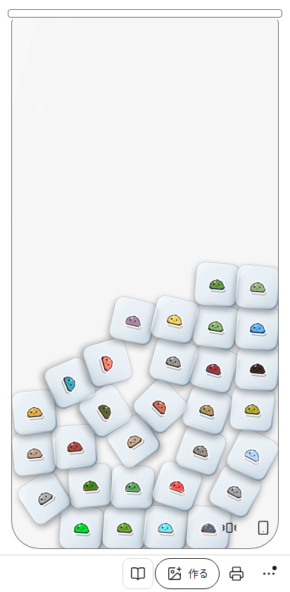
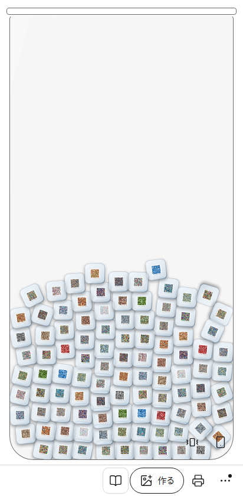
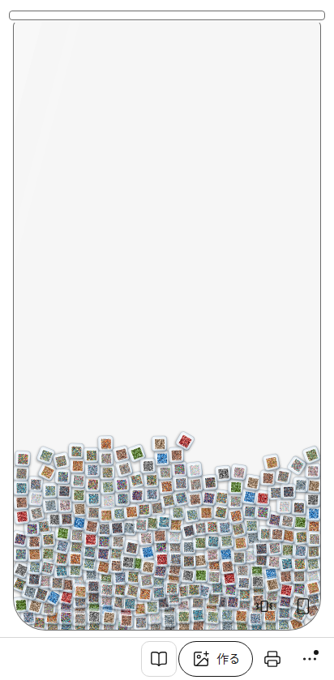

# 瓶とアクリルブロック スパイク

**本実装あり**(このレポートはスパイク時点の記録。下の数値は 300 枚を全部入れた旧版のもので、現行の瓶は 40 枚が既定・最大 120 枚。現行の数値と仕様は `docs/progress.md` と README の「瓶モード」)。ツールバーの「瓶で見る / シール帳で見る」で切り替える。実装は `src/ui/jar/`(`engine.ts` 物理と描画、`sprite.ts` ブロックの絵、`Jar.tsx`)、配置は `src/core/jar-layout.ts`(純粋、テスト付き)。

  

## 1. 物理: matter-js で試作

- 選んだ理由: 角丸の矩形(`chamfer`)、スリープ、拘束(ドラッグ用)が標準で揃い、型は `@types/matter-js`。小さく早く作れる。
- 実測の弱点: 積み上げに弱い。反復回数が位置 5 / 速度 4 だと下の段が潰れて重なった(100 枚、高さ 10 段で目視)。位置 14 / 速度 6 に上げて解消、その分のコストは 300 枚でも 1 フレーム 2ms 前後。
- バンドル: min 約 83KB(gzip 約 26KB)。配布物が CommonJS(UMD)でツリーシェイクされず全部入る。ビルドは 500KB 超の警告が出た。遅延 import(`React.lazy`)で瓶の時だけ読むのが前提。
- 決定性: `Math.random` を使わず、固定ステップで同じ初期配置から回せば再現しやすい(ID は `Common.nextId` のカウンタに依存するだけ)。ただ、ブラウザ間のビット単位の一致は保証されない。必要なのは見た目だけなので問題なし。
- lint との相性: `src/ui` の `no-let` は `const` の状態オブジェクトで回避できた。ライブラリ本体は `src/ui/jar` に閉じ込め、`src/core` に入れない。
- planck(box2d): 積み上げと接触の安定性は最良のはず(連続衝突、ウォームスタート、スリープ島)。ただし約 200KB 超でやや大きく、API が低レベル(角丸は自前の形状)。数百枚の山を確実に静止させたいなら有力。
- 自前ソルバー: 同じ大きさの角丸四角だけなら小さくできる(数 KB、`src/core` に純粋に置ける、決定的)。ただし回転する箱の積み上げと摩擦は難しく、安定させる工数が大きい。勧めない。

## 2. 描画: canvas 2D

- ブロックごとのスプライトを 1 回だけオフスクリーン canvas に描く(影、半透明の本体、32x32 の絵、縁のハイライト、斜めの反射)。毎フレームは `setTransform` + `drawImage` のみ。
- 絵は 32 の整数倍(収まる大きさのとき)かつ `imageSmoothingEnabled = false`。バッキングストアは dpr 2 で頭打ち。
- 影はスプライトに焼いたので、ブロックと一緒に回る(光の向きは本来固定)。気になるなら 2 パスにするが、描画が倍になる。
- DOM/SVG: 300 枚の `transform` 更新は毎フレーム style 書き込み 300 回になり、レイヤーも 300 枚できる。canvas を選んだ理由。読み上げは非表示の `<ul>`(アルバムと同じ名前)で補う。
- 難点: 300 枚の初期スプライト生成が 1 回 130ms ほどかかる(下の「最悪」)。

## 3. 操作

- ブロックのドラッグ(マウス・タッチ共通の Pointer Events)は、`Query.point` で当たりを取り、ポインタに柔らかい拘束を張って投げる。離すと速度が残る。`touch-action: none`、リスナーは `AbortController`。
- 「振る」ボタンは全ブロックに上向きのランダム速度。傾きは `deviceorientation` の `gamma` を重力の向きに(タッチ端末だけボタンを出す。iOS の許可は `requestPermission()` をボタンのクリックから呼ぶ)。
- 動きを減らす設定: 重力で最大 360 ステップをその場で回して 1 回描くだけ。ループ・入力・ボタンなし。`data-state="still"`。

## 4. 性能(Playwright、headless Chromium、Pixel 7 エミュレーション、dpr 2.6 → 2)

| 枚数 | 落下(約 3-5 秒)の 1 フレーム平均 / 最悪 | 振ったとき 平均 / 最悪 | 最悪 rAF 間隔 |
| --- | --- | --- | --- |
| 20 | 0.20 / 2.1ms | 0.20 / 0.4ms | 17ms |
| 100 | 0.60 / 3.0ms | 0.56 / 1.2ms | 33ms |
| 300 | 1.9 / 5.8ms | 1.95 / 3.6ms | 133ms(初回のスプライト生成) |

(ms は物理ステップ + 描画の仕事量。`e2e/jar.spec.ts` を `JAR_PERF=1` で実行)

- 施した工夫: 固定 1/60 秒のステップと 1 フレーム 3 ステップの上限(遅れは捨てる)、全ブロックが眠ったら rAF を止める(静止中のコストは 0)、スプライトの事前描画、dpr 上限 2、Matter 標準の broadphase。
- デスクトップのヘッドレスの数字であり、スマホの数字ではない。CPU は桁違いに遅い想定(目安で 4-6 倍)なので、300 枚は 10ms 前後 / 回の見込み。実機で要確認。
- 遅い端末への落とし方: ① 動いているブロックだけ物理を回す(眠ったものを遅く起こす)、② フレーム仕事量の移動平均が 10ms を超えたらステップを 30Hz に、③ 解像度を dpr 1 に、④ 枚数が多いときは動くブロックを上限(例 150)にして残りは底に固定の山、⑤ スプライト生成を数フレームに分割。

## 5. 本実装の構成案

- 切り替え: `ui/app-state.ts` の `view: "album" | "jar"`(スパイクで追加済み)。保存は `data/settings.ts` の `view`(書き込みだけ実装済み)。読み出しは `backup-mark.ts` と同じ外部ストア、または初期状態を Suspense で読む。
- `src/core`: `jar-layout.ts`(ブロックの大きさ、決定的な初期配置)。物理ライブラリは入れない。
- `src/ui/jar/`: `engine.ts`、`sprite.ts`、`Jar.tsx`、`device.ts`(動きの設定・傾き)。`Jar` は `React.lazy` で分割。
- `App.tsx`: ツールバーにトグル(空のときは出さない)。瓶の中では `PageIndicator` を隠す。
- 画面の文言は `messages.ts` の `jar`(スパイクの仮文言)。

## 結論と推奨

**go(条件付き)**。見た目と手触りは十分、300 枚でも PC では余裕。条件: 実機(低価格 Android、iPhone)で 300 枚を確認、遅延読み込み、積み上げの潰れが残るなら planck へ。

分割案: ① 切り替えと設定の保存・復元(`app-state`、`settings`、遅延 import) ② 物理とスプライトの本実装(最適化、ステップ数の自動調整、リサイズで山を保つ) ③ 操作(ドラッグ、振る、傾き、iOS の許可、ハプティクス) ④ 動きを減らす設定・読み上げ・ダークテーマ ⑤ 実機計測と必要なら planck への差し替え。

未検証: 実機、iOS の傾き許可、WebKit、ダークテーマの見た目、リサイズでの山の再生成(今は初期配置に戻る)。
