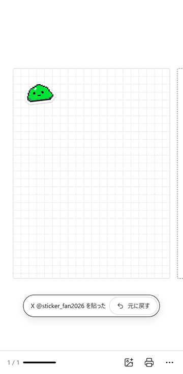
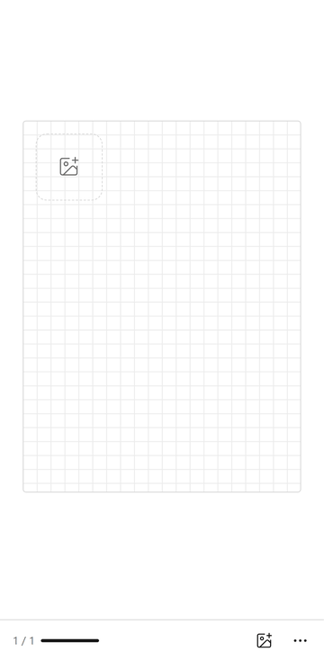

# 初めて受け取った人の画面

QRやリンク(`<app>#v1.<本文>`)から初めてアプリを開いた人が見るものを、新しいブラウザで確認した(Playwright、Pixel 7)。

## 見えるもの

1. リンクを開くと `data/inbox.ts` が `#` 以降を取り込み、`receiveFragment` が検証して IndexedDB に保存し、URL の `#` を消す。
2. 空のシール帳が1ページ開き、受け取ったステッカー1枚が貼られている(落ちるアニメーション)。右端に次ページの破線が少し見える。
3. 下に「X @sticker_fan2026 を貼った」と「元に戻す」のトースト。数秒で消える(確認時は6秒後に消えていた)。
4. 画面下のバーは「1 / 1」、作る、印刷、「…」。説明文の類は画面全体で一切ない(ページ全体のテキストは「1 / 1」とトーストだけ)。

比較: 何も受け取っていないときは、点線の枠に画像追加のアイコンが1つあるだけ(この枠はのちになくした)。

## 足りないもの

- このアプリが何か(ドット絵ステッカーのシール帳、サーバーなし)がどこにも書かれていない。トーストが消えると、貼られた理由も分からない。
- 「自分のステッカーを作って交換する」への誘いがない。作るボタンはアイコンだけで、`title` と `aria-label` にしか文字がない。
- 貼られたステッカーが保存済みで、端末のブラウザの中にだけあること、ホーム画面に追加しないと消えることがある(メニューにだけ書かれている)ことが伝わらない。

## 改善案(価値/手間の順)

1. 受け取り直後だけ、トーストの代わりに(または続けて)短い案内を出す。「ステッカー帳に貼った。自分のステッカーも作って交換できる」と、作成ダイアログを開くボタン1つ。変更: `src/ui/received.ts`(文言とアクション)、`src/ui/Toast.tsx` と `Toast.module.css`、`src/ui/feedback.ts`(アクション付きトースト)。
2. 受け取り件数が0枚から1枚になった初回だけ、トーストを長く(消えない)にして「元に戻す」を残す。初回かどうかは `src/data/settings.ts` に「案内済み」を持たせる。変更: `src/data/settings.ts`、`src/ui/received.ts`、`src/ui/Toast.tsx`。
3. 自分のステッカーがまだ0枚のとき、作るボタンに文字ラベル(「作る」)を添える。または空のページの点線枠に1行「画像から作る」を書く。変更: `src/ui/App.tsx`、`src/ui/App.module.css`、`src/ui/album/PageCanvas.tsx`。

## 実装済み

- 受け取り(新規)で、自分のステッカーが 0 枚のとき、トーストに「自分のも作る」を添えた。押すと作成ダイアログが開く。トーストは「何をするか」だけを持ち(`ToastAction`)、`App` がそれをダイアログの状態に結び付ける(関数を外部ストアに入れない)
- 端末で最初の受け取りだけ、トーストは消えず、閉じるボタン(×)で閉じる。「案内済み」は設定 `invitationShown` に保存する(`src/data/settings.ts`)。2 回目以降は、自分のステッカーがなければ「自分のも作る」付きで、6 秒で消える
- 判定は純関数 `planReceiveToast`(`src/core/receive-toast.ts`)
- 自分のステッカーが 0 枚の間だけ、作るボタンに「作る」の文字を添える。1 枚貼ったらアイコンだけに戻る。幅 320px で、トーストはボタンを折り返して収める
- 受け取りの演出: 新規に貼られたとき `navigator.vibrate(20)`(対応端末のみ。イベント経路から)と、少し大きく落ちて弾む貼り付き(`data-effect="received"`。`prefers-reduced-motion: reduce` では動かさない)。実機の振動は未確認

提案 1〜3 のうち、空のページの点線枠への一行は実装していない。
